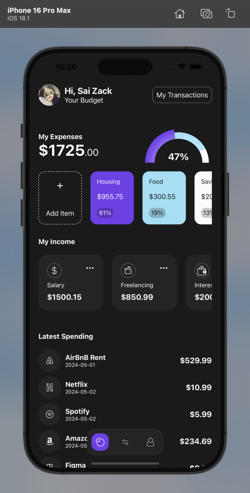

# 💵 Finance App UI

🎉 Welcome to **Finance App UI**!  

This project is a **front-end only** mobile app built just for **practice purposes** to explore and master the following **tech stacks**. There’s no back-end involved—just sleek UI design and front-end awesomeness! ✨

---
 

## 🛠️ Tech Stack

Here’s what powers this app:  

- **📱 React Native**: Cross-platform development made easy.  
- **⚡ Expo**: Rapid prototyping and deployment.  
- **📊 Victory Native**: Stunning charts and visualizations.  
- **💡 TypeScript**: For strongly typed and maintainable code.  

---

## 📂 Project Structure

Here's how the project is organized:
```
Finance App UI 
├── 📁 app 
│ ├── 📁 (tabs) 
│ │ ├── _layout.tsx # Main layout for tab navigation 
│ │ ├── index.tsx # Dashboard screen 
│ │ ├── profile.tsx # Profile screen 
│ │ ├── transaction.tsx # Transaction history screen 
├── 📁 components 
│ ├── ExpenseBlock.tsx # Component for expense display 
│ ├── IncomeBlock.tsx # Component for income display 
│ ├── SpendingBlock.tsx # Component for spending stats 
│ ├── TabItems.tsx # Bottom tab icons and labels 
├── 📁 constants 
│ ├── Colors.tsx # Color palette for the app 
│ ├── Icons.tsx # Icon definitions 
├── 📁 data 
│ ├── expenses.json # Sample expense data 
│ ├── income.json # Sample income data 
│ ├── spending.json # Sample spending data 
├── 📂 assets 
│ ├── project-preview.png # Preview image for the README 
├── app.json # Expo configuration 
├── package.json # Dependencies and scripts 
├── tsconfig.json # TypeScript configuration
```

---
## 📸 Preview

<div>
  
</div>

----------

## ⚙️ Installation

1. Clone the repository:  
	```bash
	git clone https://github.com/your-username/finance-app-ui.git
	```

2.  Navigate to the project folder:
    
    ```bash
    cd finance-app-ui
    ```
    
3.  Install dependencies:
    
    ```bash
    npm install
    ```
    
4.  Start the app:
    
    ```bash
    npx expo start
    ```
 5.  Run the App on Simulator or Emulator:
    
   -   Type  `a`  for Android
        
   -   Type  `i`  for iOS

----------

## 🌈 Contributions

This is a practice project, but feel free to fork it and experiment! Suggestions or improvements are always welcome. 🚀

----------

### 📩 Contact

For any questions or feedback, feel free to reach out:  
 **GitHub:** [sai-zack-dev](https://github.com/sai-zack-dev)
**Email:** [saizlinh@gmail.com](mailto:saizlinh@gmail.com)
